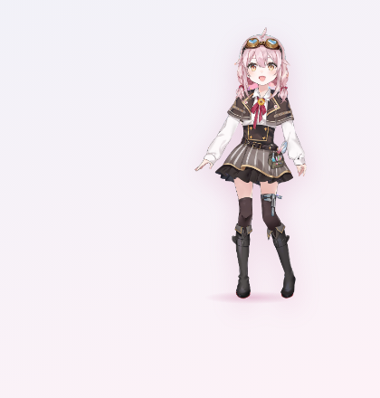
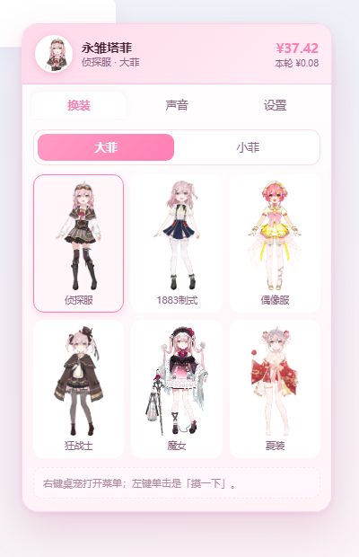
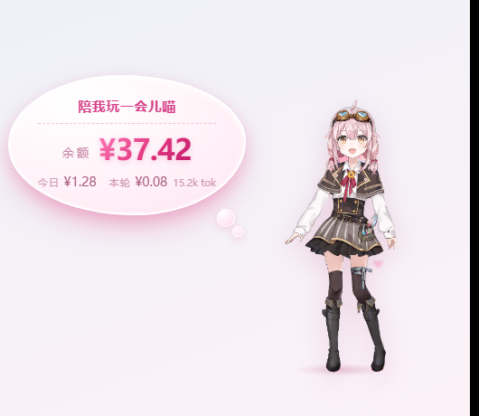

# dsh-taffy-pet · 永雏塔菲桌宠

给 DeepSeek Harness 加一只塔菲桌宠：右下角常驻一只透明立绘，能换装、能摸、会说话、会报余额。

<p align="center">
  
  
  
</p>

- **大菲 / 小菲** 两种形态，一键切换
- **7 套全身透明立绘**（侦探服 / 1883 制式 / 偶像服 / 狂战士 / 魔女 / 保健委员 / 夏装），丢文件就能加新套装
- **点击有反应**：按下压扁、松手回弹，冒爱心、随机弹一句台词
- **按压随机语音**：内置 68 段塔菲语音，同一条播放规则下**新的一句会掐掉上一句**，不重叠
- **余额气泡**：粉色调语音泡，点击时弹出余额 / 今日 / 本轮消耗，自动避让屏幕边缘
- **四边吸附 + 甩抛**：拖到任意一边自动贴边；快速甩出去会带惯性飞一段、撞边回弹再吸附
- **工作状态联动**：宿主把 thinking / working / waiting / success / error 六档状态喂给桌宠，切换时描边变色 + 冒一句台词；窗口失焦时任务结束会发系统通知
- **碎碎念（默认关）**：间隔 30/45/60/120 分钟，只在「页面可见 + 5 分钟没互动 + 非静默时段(23:00–09:00)」时说话
- **高分屏**：manifest 带 `file2x` 时自动走 `@2x` 素材（srcset）
- **省电**：页面不可见时停掉动画帧与轮询；`prefers-reduced-motion` 下自动关闭回弹与漂浮动画
- **计费**：完整沿用 [DeepSeek-Balance-Whale-Widget](https://github.com/MeteorNOX/DeepSeek-Balance-Whale-Widget) 的宿主与账本

本项目 fork 自 [MeteorNOX/DeepSeek-Balance-Whale-Widget](https://github.com/MeteorNOX/DeepSeek-Balance-Whale-Widget)（MIT）：
**宿主层（计费、账本、`/dsh-whale/*` 路由）保持不变**，浏览器端脚本整体重写为塔菲桌宠。
因此它继续读写原来的 `.dshw-size.json` / `.dshw-usage.json`，计费历史与登记方式全部继承。

> 素材（立绘、语音）来自永雏塔菲官方/二创公开素材，仅用于个人本地桌宠；版权归原作者所有，请勿商用。

---

## 安装

```bash
# 在 DSH profile 目录里（例如 ~/.dsh/profiles/desktop/）
npm i dsh-taffy-pet        # 或 pnpm add / 用 link: 指向本地目录
```

然后在 profile 的 `package.json` 里把包加进 bundles：

```json
{
  "dsh": {
    "profile": {
      "bundles": ["dsh-taffy-pet"]
    }
  }
}
```

> 如果你之前装过 `dsh-whale-widget`，请把它从 bundles 里去掉——两个插件都会注册
> `/dsh-whale/widget.js`，同时启用会看到旧挂件。

**重启一次 DeepSeek Harness**。插件第一次启动时会把自带的立绘与语音铺到用户目录
（只补缺、不覆盖），之后改素材不需要重启。

## 交互

| 操作 | 效果 |
| --- | --- |
| 左键单击 | 摸一下：随机语音 + 压扁回弹 + 小爱心 + 随机台词 + 弹出余额气泡 |
| 右键单击 | 打开菜单（默认停在「设置」） |
| 拖动 | 移动位置，松手吸附到最近的边；位置会记住 |
| Ctrl + 滚轮 | 缩放（以底边为锚，位置不跳） |

## 菜单

- **换装**：大菲 / 小菲切换 + 套装网格（小菲只显示有 Q 版素材的套装）
- **声音**：按压音效开关、音量、语音池数量、全部语音列表（点哪条放哪条）
- **设置**：大小、气泡 / 今日 / 本轮开关、刷新间隔、回到右下角、刷新余额、收起桌宠、打开素材目录、重新加载桌宠

## 素材目录

素材放在 `~/.dsh/taffy-pet/`（Windows：`C:\Users\<你>\.dsh\taffy-pet\`），
通过宿主路由 `/dsh-whale/taffy-file?p=<相对路径>` 只读访问。

```
~/.dsh/taffy-pet/
└── art/
    ├── manifest.json        # 套装索引
    ├── outfits/             # 大菲全身立绘（透明 PNG）
    └── small/               # 小菲 Q 版（透明 PNG）
```

`manifest.json`：

```json
{
  "version": 2,
  "outfits": [
    {
      "id": "detective",
      "name": "侦探服",
      "file": "detective.png",
      "w": 455,
      "h": 1100,
      "small": "small/small-detective.png",
      "smallW": 354,
      "smallH": 700
    }
  ]
}
```

`file` 相对 `outfits/`，`small` 相对 `art/`；没有 `small` 的套装在小菲页签里不显示。
改完素材重开菜单即可生效（菜单每次打开都会重新读 manifest）。

## 语音

语音在 `~/.dsh/whale-audio/`：`<id>.wav` + `audio.json` 的 `fragments` 列表。
前端优先使用 id 以 `tv-` 开头的片段（塔菲语音池），没有才回落到 `taffy-*` 或内置 `Ya1/Ya2`。

## 路由

所有 `/dsh-whale/*` 都过同源校验，未登录返回 401。桌宠新增：

| 路由 | 说明 |
| --- | --- |
| `GET /dsh-whale/taffy-file?p=art/manifest.json` | 读取 `~/.dsh/taffy-pet/` 下的素材（路径白名单 + 目录锁定） |

其余（`balance.json` / `usage-records.json` / `size.json` / `audio.json` / `audio-fragment.wav` / `role-*` …）沿用上游实现。

## 状态接口（给宿主/其它插件用）

`GET /dsh-whale/pet-state.json` → `{ ok, activity: { status, detail, ts, session }, ui }`

`status` 取值：`idle | thinking | working | waiting | success | error`。宿主在 turn/tool 事件里自动更新，前端 2.6s 轮询一次。

`PUT /dsh-whale/pet-state.json` body `{ ui: {...} }` → 把桌宠的位置/大小/开关写到 `~/.dsh/taffy-pet/ui-state.json`，换浏览器或清缓存后仍在原位。

## 开发

```bash
npm run check     # 三个入口文件的语法检查
```

前端是单文件 `lib/whale-widget.js`（IIFE，`window.__TAFFY_PET_BOOTED__` 防重复注入），
样式全部内联注入到 `#tp-root` 作用域，不污染宿主页面。

## English

A Taffy (永雏塔菲) desktop pet for DeepSeek Harness: a transparent, draggable widget pinned in the corner of the GUI.

- Two forms (full-size / chibi), 7 transparent outfits, hot-swappable by dropping files into `~/.dsh/taffy-pet/art/`
- Click to pet: squash-stretch feedback, hearts, a random Taffy line and one voice clip (new clip cuts the previous one)
- Drag with throw physics and edge snapping; Ctrl+wheel to resize (anchored to the bottom edge)
- Pink speech bubble shows balance / today / this-turn spend, auto-placed on whichever side of the pet has room
- Six-stage activity bridge (`thinking / working / waiting / success / error`) colours the pet and speaks; system notification on task completion while the window is in the background
- Optional idle chatter (off by default), quiet hours, reduced-motion support, 2x assets for HiDPI

Install, then add `dsh-taffy-pet` to your profile's `dsh.profile.bundles`:

```bash
dsh plugin --profile desktop add github:111xjyuan/dsh-taffy-pet
```

Billing/host layer is inherited from [DeepSeek-Balance-Whale-Widget](https://github.com/MeteorNOX/DeepSeek-Balance-Whale-Widget) (MIT). Character assets belong to their original authors; personal use only.

## License

MIT。宿主层与计费逻辑来自 [MeteorNOX/DeepSeek-Balance-Whale-Widget](https://github.com/MeteorNOX/DeepSeek-Balance-Whale-Widget)。
角色形象「永雏塔菲」版权归其著作权人所有，本项目仅为非商用的个人桌宠实现。
